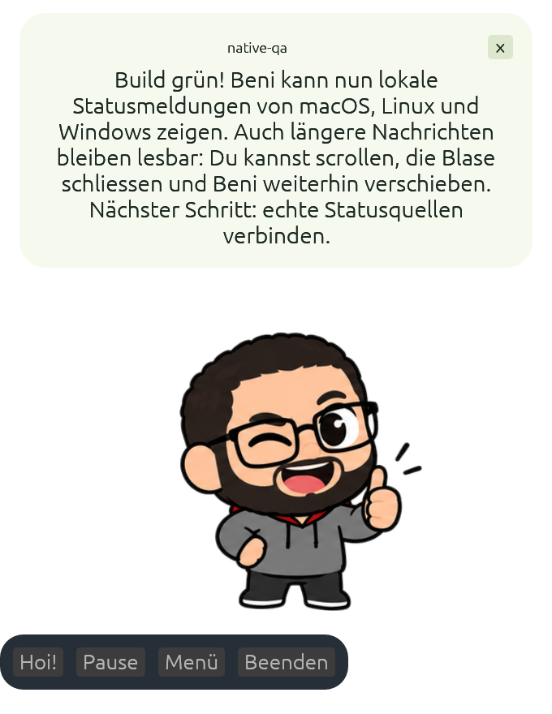

# Beni Desktop Buddy

Mini-Beni als nativer Desktop-Buddy in Rust: ein animierter Begleiter auf dem Desktop, mit transparentem Fenster, Gesten und Sprechblasen.


Die native Rust-Grundlage ist auf macOS gestartet und visuell geprüft. Tests, Clippy und Release-Builds bestehen in GitHub Actions auf macOS, Windows und Linux.




## Aktueller Stand

- **Implementiert und getestet:** unabhängiger Rust-Animationskern, 44 Posen, 20 Animationen, SDK-kompatible Bewegung, Aliase, One-shot → Idle, Pause, Tempo, Spiegelung, reduzierte Bewegung und Asset-Validierung.
- **Auf macOS gebaut und gestartet:** Desktop-App mit egui/eframe, transparentem Fenster, Verschieben per Ziehen, Sprechblase, Animationsmenü, Einstellungen und lokalem Speichern der Einstellungen/Fensterposition.
- **Lokale Statusmeldungen:** opt-in, begrenzte Warteschlange, einfache Gestenregeln, CLI `notify` und `run`, Unix-Socket auf macOS/Linux und benutzergeschützte Named Pipe auf Windows.
- **CI bestanden:** Kern, CLI und Desktop auf macOS, Windows und Linux. Download-Artefakte, macOS-App-Bundle, Roadmap und manuelle Abnahmeliste sind vorhanden.
- **GitHub:** [Witzelfitz/beni-desktop-buddy](https://github.com/Witzelfitz/beni-desktop-buddy), privat.

Kein WebView und kein JavaScript zur Laufzeit: Der bestehende Beni-Animationsansatz wird in Rust berechnet und aus dem originalen PNG-Atlas gezeichnet. Grafik und Daten sind im Binary eingebettet.

## Start

Rustup und die üblichen nativen Build-Werkzeuge installieren. `rust-toolchain.toml` legt Rust 1.99.0 mit rustfmt und Clippy für lokale Builds und CI fest; rustup installiert die Toolchain bei Bedarf automatisch. Die Manifeste deklarieren weiterhin Rust 1.95 als Mindestversion. Unter macOS benötigt der Build die Xcode Command Line Tools, unter Windows die MSVC Build Tools.

Im Repository:

```sh
# Animationskern prüfen – benötigt kein Desktopfenster.
cargo test --workspace --locked
cargo run --locked -p buddy-cli -- validate-assets
cargo run --locked -p buddy-cli -- states
cargo run --locked -p buddy-cli -- sample wave 321

# Desktop starten. Beim ersten Mal werden die GUI-Abhängigkeiten geladen.
cargo run --manifest-path apps/desktop/Cargo.toml --locked
```

Beide Cargo-Workspaces enthalten ein committedes Lockfile. Builds und Tests verwenden `--locked`, damit dieselben Abhängigkeiten geladen werden.

Unter Debian/Ubuntu braucht die GUI beispielsweise:

```sh
sudo apt-get install libxkbcommon-dev libxkbcommon-x11-dev libwayland-dev libx11-dev libxext-dev libxi-dev libxrandr-dev libxcursor-dev libgl1-mesa-dev
```

Linux-Desktop-/Compositor-Verhalten muss separat abgenommen werden. Ein erfolgreicher Build belegt noch keine Transparenz oder Vordergrunddarstellung.

## Bedienung

| Aktion | Bedienung |
| --- | --- |
| Beni verschieben | Beni mit der linken Maustaste ziehen |
| Bedienleiste auf-/zuklappen | Beni anklicken; beim Start ist die Leiste eingeklappt |
| Bedienung ohne Maus | Bei fokussiertem Buddy-Fenster mit Tab zu Beni oder einem Bedienelement wechseln; Eingabe oder Leertaste aktiviert es |
| Beni anzeigen / ausblenden | «Beni» in der Menüleiste → «Beni anzeigen» / «Beni ausblenden» |
| Verlorenen Beni zurückholen | «Beni» in der Menüleiste → «Beni zurückholen» (Hauptbildschirm) |
| Begrüssen | Bedienleiste aufklappen → «Hoi!» |
| Pause/Fortsetzen | «Pause» / «Weiter» |
| Animation auswählen | «Menü» → Animation |
| Energie, Tempo, Spiegelung | «Menü» |
| Beni-Grösse | «Menü» → «Klein», «Mittel» oder «Gross»; die Auswahl bleibt nach Neustart erhalten |
| Globale Tastenkürzel | «Menü» → «Tastenkürzel» → Kombinationen wählen und «Globale Hotkeys aktivieren» |
| Weniger Bewegung | «Menü» → «Weniger Bewegung» |
| Hintergrund durchklickbar | Standardmässig aktiv; im Menü abschaltbar. Beni, sichtbare Bedienleiste und Sprechblasen bleiben anklickbar |
| Eigene Sprechblase | Nachricht im Menü eingeben; lange Texte scrollen; Blase anklicken oder mit × schliessen |
| Status von lokalen Programmen | «Menü» → «Statusmeldungen empfangen», danach CLI `notify` oder `run` |
| Vordergrunddarstellung | «Menü» → «Immer im Vordergrund» |
| Menü und Bedienleiste schliessen | Escape oder Beni erneut anklicken |
| Beenden | «Beenden» im Fenster oder Tray; Alt/Option + Q bei fokussiertem Buddy-Fenster |

Die Bedienleiste erscheint erst nach einem Klick auf Beni. Ein weiterer Klick oder Escape klappt sie wieder zu und schliesst offene Einstellungen. Benis Grösse und Position bleiben beim Auf-/Zuklappen gleich; aktive Statusmeldungen behalten Text, Quelle, Geste und Anzeigedauer. Ziehen klappt die Leiste nicht auf. Das Tray-Menü ist auch bei eingeklappter Bedienung verfügbar.

Die native Accessibility-Anbindung über [eframes AccessKit-Feature](https://docs.rs/eframe/0.36.2/eframe/#feature-flags) ist aktiviert. Beni wird als beschrifteter Button mit Auf-/Zuklappzustand dargestellt; die Sprechblase hat einen benannten Schliessen-Knopf, und das Nachrichtenfeld einen festen Namen. Tab, Eingabe und Leertaste bedienen auch die eingeklappte Leiste. Eine vollständige Abnahme mit VoiceOver, NVDA und Orca bleibt separat zu prüfen.

38 Desktoptests prüfen UI-Ereignisse, Grössenwahl und Speicherung, Hotkey-Eingaben, Konflikte, Ereignisse und Abschalten, Eingabegeometrie samt PNG-Alpha/DPI, Accessibility-Baum und Aktionen, Tastaturbedienung, ein-/ausgeklappte Bedienung, Fehlerablauf, Bedienbarkeit bei Zeichenfehlern, Tray-Aktionen ohne Zeichnen und Fensterpositionen. Fenster-/Compositor-Verhalten auf Windows/Linux sowie die vollständige manuelle Abnahme bleiben separat zu prüfen.

«Klein» verwendet eine Zeichenfläche von 300 × 360 Punkten, «Mittel» die bisherige Grösse von 340 × 440 und «Gross» 420 × 560. Schrift und Bedienelemente behalten ihre Grösse; das Einstellungsmenü passt in das jeweilige Fenster und lässt sich scrollen. Aktive Meldungen behalten beim Wechsel Text, Quelle, Geste und Anzeigedauer. Fehlende oder beschädigte Grösseneinstellungen fallen auf «Mittel» zurück. Nach einer Vergrösserung wird die Fensterposition erneut geprüft; unter Wayland bestimmt weiterhin der Compositor die Platzierung.

Das Tray-Menü bietet auch Pause/Fortsetzen und Einstellungen. Gespeicherte Positionen werden beim Start und nach Änderungen der Bildschirme geprüft; vollständig verlorene Fenster werden automatisch zurückgeholt. Auf macOS berücksichtigt dies Menüleiste, Dock und Retina-Punkte. Eine Fehlermeldung verschwindet nach sechs Sekunden oder bei einer erfolgreichen Aktion; bei einem Zeichenfehler bleibt eine bedienbare Ersatzfläche sichtbar.

Unter Linux braucht das Tray einen StatusNotifier-Host (KSNI, beispielsweise in KDE oder über eine passende GNOME-Erweiterung). Unter Wayland bestimmt der Compositor die Fensterposition; das Begrenzen und gezielte Zurückholen auf den Hauptbildschirm ist dort nicht garantiert. Wenn das Erstellen des Tray fehlschlägt, erhält das Fenster eine normale Titelleiste; auf macOS erscheint zusätzlich ein Dock-Eintrag.

Die Sprechblase passt ihre Höhe an, bietet bei langen Texten Scrollen und eine Anzeigedauer nach Lesezeit (4–30 Sekunden, bei Statusmeldungen zusätzlich durch TTL begrenzt). Sie zeigt Text ohne Audioausgabe. Einzelaktionen kehren nach einem Durchlauf zu «warten» zurück. Einstellungen werden lokal gespeichert. Idle zeichnet mit bis zu 15 fps, aktive Gesten mit bis zu 30 fps; Pause und reduzierte Bewegung mit bis zu 4 fps.

Transparente Flächen leiten Mausklicks an das darunterliegende Fenster weiter. Die Eingabegeometrie folgt der gezeichneten Beni-Silhouette, Sprechblase, Bedienleiste und Einstellungen. Auf macOS stellen passive Mausbewegungsereignisse das Fenster vor dem nächsten Klick passend um; Tastaturereignisse werden dafür nicht überwacht. Windows verwendet Fensterregionen, Linux X11 Input Shapes und Wayland Oberflächen-Eingaberegionen. Ohne verfügbares Tray oder bei nativen Fehlern bleibt die normale Fensterbedienung erhalten. Autostart bleibt offen.

Globale Hotkeys sind bei neuen Installationen ausgeschaltet. Die Vorschläge sind `Ctrl+Alt+B` zum Anzeigen und Zurückholen auf den Hauptbildschirm sowie `Ctrl+Alt+P` zum Pausieren/Fortsetzen der Animation. Du kannst die Texte ändern und mit «Hotkeys übernehmen» anwenden; ohne Aktivierung werden nur die Kombinationen gespeichert. Kombinationen verwenden beispielsweise `Ctrl`, `Alt`/`Option`, `Shift`, `Cmd`/`Super` und eine Taste. `Super` bezeichnet die Windows-/Cmd-Taste; Buchstaben verwenden US-Tastenpositionen (Y/Z bei QWERTZ vertauscht). Einzelne Funktionstasten wie `F8` sind ebenfalls möglich. Normale Tasten brauchen Ctrl, Alt/Option oder Cmd/Super; doppelte Kombinationen und Medientasten werden abgelehnt.

Bei einer belegten neuen Kombination bleiben die bisherigen Hotkeys aktiv. Abschalten gibt die Registrierungen frei; ein gehaltenes Kürzel löst nur einmal aus. Auswahl und Aktivierung bleiben nach Neustart erhalten. [global-hotkey 0.8.0](https://docs.rs/global-hotkey/0.8.0/global_hotkey/) liefert die Ereignisse auf macOS, Windows und Linux/X11. Auf macOS fordert Beni zusätzlich exklusive Carbon-Registrierungen an, damit eine bereits von einer anderen App belegte Kombination als Konflikt erkannt wird. Unter Wayland ist die Funktion deaktiviert und im Menü entsprechend beschriftet; auch XWayland in einer Wayland-Sitzung wird nicht als systemweite Unterstützung ausgegeben. Die App empfängt nur Ereignisse ihrer registrierten Kombinationen und protokolliert keine Tastatureingaben.

Linux-CI prüft Eingaberegionen zusätzlich mit Xvfb und einem separaten Weston-Headless-Server (`bash scripts/check-input-linux.sh`) sowie tatsächliche X11-Hotkey-Registrierung, Konflikterkennung und Freigabe. Das ersetzt keine vollständige Desktop-Abnahme mit einem echten Compositor und gemischter DPI.

## Entwicklung

```sh
./scripts/check.sh
./scripts/check.sh --desktop
./scripts/package-macos.sh
```

Das macOS-Script erstellt nach erfolgreichem Build `dist/Beni Buddy.app`, einschliesslich CLI, Integrationsvorlagen und App-Icon. Es signiert beide ausführbaren Dateien und das fertige Bundle ad hoc und prüft die Signatur streng. Das Paket wird erst danach aus dem temporären Build-Verzeichnis übernommen. Das Entwicklungsbundle ist nicht notarisiert; für öffentliche Verteilung sind Developer-ID-Signierung und Notarisierung weiterhin offen. Es führt keinen Autostart oder OS-Installation aus.

Das App-Icon ist als PNG, ICNS und ICO samt Provenienz vorhanden. Windows bindet das ICO in die ausführbare Datei ein; Windows/Linux erhalten ausserdem das Fenster-Icon. Linux-Pakete enthalten eine Desktop-Datei als Installationsvorlage: Programm in einen Benutzer-Binärpfad, Desktop-Datei unter `~/.local/share/applications/` und `icons/beni.png` unter `~/.local/share/icons/hicolor/1024x1024/apps/io.witzelfitz.beni-buddy.png` ablegen. Eine automatische Installation wird nicht vorgenommen. Der Icon-Export lässt sich auf macOS mit `python3 scripts/export-app-icon.py` aus dem freigegebenen Raster-Master wiederholen.

Der Kern liegt im Root-Workspace. Die Desktop-App bildet wegen ihrer eigenen GUI-Abhängigkeiten einen separaten Cargo-Workspace. Root-Tests bauen deshalb ausdrücklich **nicht** die Desktop-App. Der GitHub-Workflow prüft beide Workspaces in einem gemeinsamen Job je Betriebssystem: Linux, macOS und Windows. Formatierung, Tests, Clippy und die nativen Linux-Smoke-Tests bleiben enthalten.

Feature-Branches werden über Pull Requests auf `main` geprüft; automatische Push-Prüfungen laufen nur auf `main`. Reine Änderungen an der Root-README, `docs/` und den Issue-/PR-Vorlagen starten keine CI. Neue Änderungen brechen ältere Läufe desselben PRs oder Branches ab. Die Matrix stoppt nach einem Fehler weitere Jobs; jeder Job hat höchstens 25 Minuten Laufzeit. [Rust Cache](https://github.com/Swatinem/rust-cache) speichert Cargo-Downloads und kompilierte Abhängigkeiten beider Workspaces, getrennt nach Plattform, Toolchain und Abhängigkeitsstand. Caches werden auf `main` gespeichert und von PRs gelesen; eigene grosse Caches pro PR entfallen. Der erste Lauf auf `main` baut den Cache auf.

Pull Requests bauen die Desktop-App im Debug-Profil. Release-Builds und Download-Artefakte entstehen bei Code-/Workflow-Pushes auf `main` oder manuell über **Actions → Rust checks → Run workflow → «Release-Pakete für alle drei Plattformen bauen»**. Dabei den gewünschten Branch auswählen; ohne Haken führt der manuelle Lauf nur die Prüfungen und den Debug-Build aus. Auch nach reinen Dokumentationsänderungen können Pakete so bewusst neu erstellt werden. Die Archive bleiben sieben Tage verfügbar: ein `.app`-Bundle für macOS und ausführbare Dateien für Windows/Linux, jeweils mit CLI, Wrappern und Anleitung in einem `.tar.gz`-Archiv. Wer einen PR vor dem Merge im Release-Profil prüfen möchte, verwendet diesen manuellen Paket-Lauf.

## Struktur

```text
assets/beni/                  Originalatlas, Animationen, Aliase und SHA-256-Provenienz
crates/buddy-core/            Deterministische Rust-Engine und Tests
crates/buddy-cli/             CLI, notify/run und Prozess-Integrationstests
crates/buddy-ipc/             Geschützter lokaler Transport und Hintergrundlistener
integrations/                Shell, PowerShell und optionale Codex-/Claude-Code-Hooks
apps/desktop/                Native egui/eframe-App
.github/workflows/ci.yml      Kern- und Desktopchecks auf drei Plattformen
scripts/                     Prüfungen, GitHub-Veröffentlichung und macOS-Packaging
docs/                       Architektur, Roadmap, GitHub-Anleitung, Abnahme, Prüfbericht
```

- [Statusmeldungen einrichten: Mac, Linux und Windows](docs/INTEGRATIONS.md)
- [Lokaler Nachrichtenvertrag](docs/adr/0002-local-status.md)
- [Architektur](docs/ARCHITECTURE.md)
- [Entscheidung für native Rust-GUI](docs/adr/0001-native-rust.md)
- [Roadmap mit konkreten Arbeitspaketen](docs/ROADMAP.md)
- [GitHub-Erstellung und PR](docs/GITHUB.md)
- [Manuelle Desktop-Abnahme](docs/TEST_MATRIX.md)
- [Tatsächlich ausgeführte Prüfungen](docs/VALIDATION.md)
- [Rechte und Asset-Herkunft](LICENSE.md)

Technische Referenzen: [eframe 0.36.2](https://docs.rs/eframe/0.36.2/eframe/), [transparentes Fenster](https://docs.rs/egui/0.36.2/egui/viewport/struct.ViewportBuilder.html#method.with_transparent), [native Fensteraktionen](https://docs.rs/egui/0.36.2/egui/viewport/enum.ViewportCommand.html).
