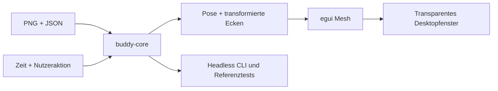

# Architektur

`buddy-core` lädt und validiert den eingebetteten Atlas, die Animationen und Aliase. `pose_at` berechnet Segment, Translation, Rotation, Skalierung und Spiegelung aus expliziter Zeit und Energie. `corners` transformiert die Bildkoordinaten um denselben Bodenanker wie das bisherige SDK.

`Player` verwaltet die aktuelle Animation, deren Zeit, Pause und einmalige Wiedergabe. Eine neue Aktion unterbricht die bisherige Aktion. Nach einer einmaligen Aktion folgt Idle. Ungültige Namen oder Zeitschritte verändern den Player nicht.

`buddy-cli` stellt Asset-Validierung, Animationsliste und JSON-Ausgabe einer Pose bereit. Die CLI ist ein Prüfwerkzeug; sie steuert noch keinen separat laufenden Desktopprozess.

`apps/desktop` lädt das PNG einmal als GPU-Textur und zeichnet vier transformierte Ecken mit den Atlas-UV-Koordinaten. egui stellt Sprechblase, Bedienleiste und Einstellungen dar. eframe verwaltet Fenster, Eventloop und lokale Persistenz.

## Datenweg

## Erweiterungspunkte

Tray und globale Shortcuts gehören in einen Plattformadapter. Erinnerungen können einen getrennten Scheduler bekommen, der über dieselben `Player::play`-Aktionen arbeitet. Für eine spätere lokale IPC-Steuerung braucht es einen expliziten Aktionsvertrag, begrenzte Nachrichten und einen Nutzer- oder Prozessgebundenen Transport; in diesem Stand existiert kein Listener.

## Persistenz

Es werden Energie, Tempo, Spiegelung, reduzierte Bewegung und Vordergrunddarstellung gespeichert. eframe kann zusätzlich die Fensterposition speichern. Persistierte Werte werden vor der Verwendung bereinigt. Die Sprechblaseneingabe wird nicht persistiert.
