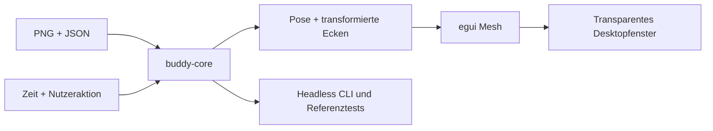

# Architektur

`buddy-core` lädt und validiert den eingebetteten Atlas, die Animationen und Aliase. `pose_at` berechnet Segment, Translation, Rotation, Skalierung und Spiegelung aus expliziter Zeit und Energie. `corners` transformiert die Bildkoordinaten um denselben Bodenanker wie das bisherige SDK.

`Player` verwaltet die aktuelle Animation, deren Zeit, Pause und einmalige Wiedergabe. Eine neue Aktion unterbricht die bisherige Aktion. Nach einer einmaligen Aktion folgt Idle. Ungültige Namen oder Zeitschritte verändern den Player nicht.

`buddy-cli` stellt Asset-Validierung, Animationsliste und JSON-Ausgabe einer Pose bereit. `notify` sendet zusätzlich eine Statusmeldung an den freigegebenen lokalen Listener. `run` führt das ausdrücklich übergebene Programm aus und meldet Start und Exitstatus; die App bleibt optional.

`apps/desktop` lädt das PNG einmal als GPU-Textur und zeichnet vier transformierte Ecken mit den Atlas-UV-Koordinaten. egui stellt Sprechblase, Bedienleiste und Einstellungen dar. eframe verwaltet Fenster, Eventloop und lokale Persistenz. Die Einstellungen verwenden einen eigenen nativen Immediate-Viewport mit derselben App-Instanz. Seine Fläche wird nicht in Benis Hit-Map aufgenommen; Grössen- und Vordergrundkommandos für den Buddy adressieren ausdrücklich den Root-Viewport. Ein eng begrenzter, versionierter [eframe-Patch](../vendor/eframe/BENI_PATCH.md) erhält AccessKit für zusätzliche Glow-Fenster.

## Datenweg

## Erweiterungspunkte

Tray und IPC liegen in Plattformadaptern. `buddy-ipc` verarbeitet ein begrenztes JSON-Zeilenprotokoll auf Unix-Socket beziehungsweise Windows-Named-Pipe und weckt die Oberfläche auch ohne Renderpass. `buddy-core::notifications` prüft Inhalte und verwaltet Zeit, Reihenfolge, Priorität und Quellengrenzen unabhängig vom Betriebssystem. Der Desktop-Timer erhält monotone Zeit explizit, verwaltet eine Fokus- oder Pausenphase und tickt in `App::logic` auch ohne Zeichenphase. Er erzeugt pro Abschluss einen Verlaufseintrag sowie höchstens eine bis zu 120 Sekunden wartende Anzeige. Der gemeinsame Anzeigepfad gibt IPC-Meldungen Vorrang und berücksichtigt Sichtbarkeit, Nicht stören, Nachlesen, Fehler und bestehende Blasen. Nur die konfigurierten Minuten werden gespeichert, kein laufender Countdown. Weitere Erinnerungen können denselben `Player::play`-Pfad verwenden. Der implementierte Statusvertrag erlaubt ausschliesslich Text und bekannte Gesten; [ADR 0002](adr/0002-local-status.md) beschreibt Transport und Grenzen. Weitere Fernaktionen und Modelle sind nicht Bestandteil dieses Vertrags.

## Persistenz

Es werden Energie, Tempo, Spiegelung, reduzierte Bewegung und Vordergrunddarstellung gespeichert. eframe kann zusätzlich die Fensterposition speichern. Persistierte Werte werden vor der Verwendung bereinigt. Die Freigabe für Statusmeldungen wird separat im Desktop gespeichert. Sprechblaseneingaben, empfangene Texte und Warteschlange werden nicht persistiert.
