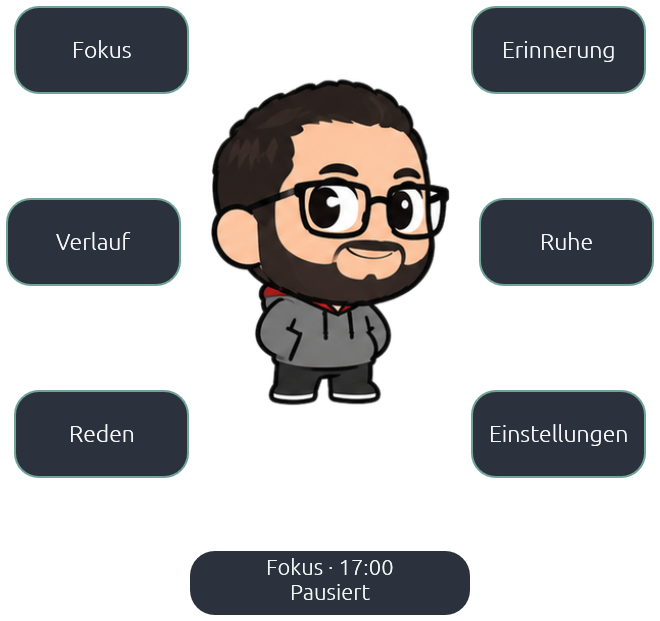
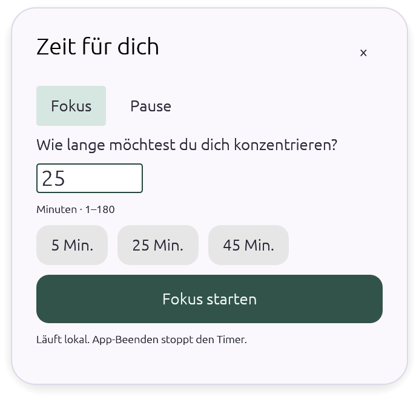
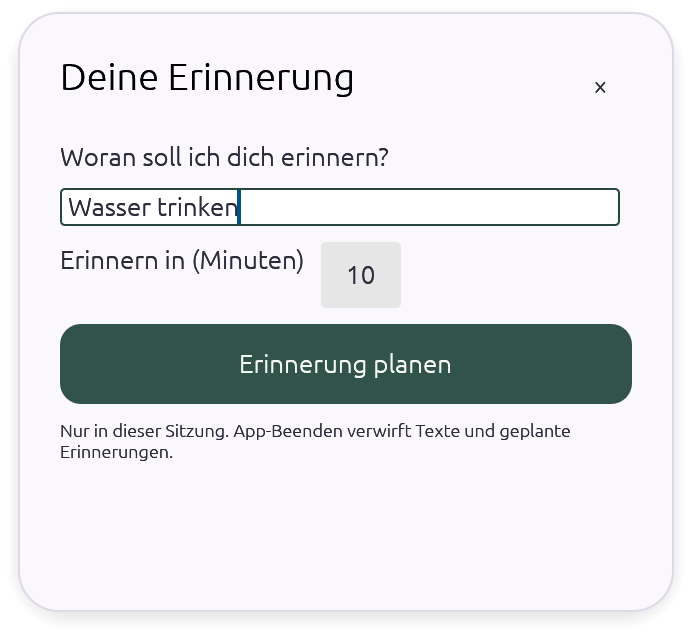

# Kompakte Bedienung: echte App-Vorschau

Entwicklung nach 0.1.6/Build 7. Dieser Stand wird per PR abgenommen; der öffentliche Installer enthält noch die vorherige Bedienung. Bilder stammen aus der eigenen nativen Mac-App, ohne Desktopaufnahme oder nachgebaute Bedienelemente. SHA-256 und Quellstand: [Provenienz](images/compact-ui/provenance.json). Die Beni-Rechte bleiben erhalten.

## Menü-Rad

Fokus und Erinnerung stehen oben, Verlauf und Ruhe in der Mitte, Reden und Einstellungen unten. Texttasten ohne Verbindungslinien geben Beni mehr Abstand. Im geöffneten Rad wird die Figur passend kleiner gezeichnet; nach dem Schliessen wird die ursprüngliche Darstellung exakt wiederhergestellt. Das Buddy-Fenster wird dafür weder verschoben noch vergrössert. Selbst breite Gesten bleiben mindestens acht Punkte von den Tasten entfernt. Bei wenig Platz bleibt eine begrenzte, scrollbar bedienbare Aktionsfläche erreichbar.

## Fokus und Erinnerung

Die rahmenlosen Karten haben eine eigene, helle Oberfläche und öffnen neben Beni. Fokus bietet Minuten, kurze Vorgaben sowie Fokus/Pause. Erinnerungen verwenden denselben Entwurf und dieselbe begrenzte Warteschlange wie die vollständigen Einstellungen. Das erste Eingabefeld erhält sofort den Fokus. Enter bestätigt gültige Eingaben; Escape oder × schliesst die Karte und erhält den Entwurf für diese App-Sitzung. Nach erfolgreicher Bestätigung erscheint das Rad mit dem aktuellen Zustand. Leere oder ungültige Eingaben starten nichts; volle Erinnerungslisten nehmen keine weiteren Einträge an.

Aktive Timer lassen sich in derselben Karte unterbrechen, fortsetzen und abbrechen. Karten können am Titel gezogen werden. Die vollständigen Einstellungen bleiben über Zahnrad/Tray erreichbar; Reden bleibt die bestehende Gesprächsblase, der Verlauf die kompakte Liste an Beni. Timer, Erinnerungen und Entwürfe werden beim App-Beenden weiterhin verworfen. Es gibt keine neue Speicherung, Anbieter oder Zugriffsberechtigungen.

Die Karten messen 348 × 332 beziehungsweise 348 × 320 Punkte. Der Inhalt scrollt bei Platzmangel. Die Positionierung berücksichtigt den Bildschirm mit Beni, Arbeitsflächen und negative Bildschirmkoordinaten. Unter Wayland übernimmt der Compositor die Platzierung; eine exakte Verankerung ist dort nicht garantiert.

## Abnahme

- Lokale Root-Prüfungen und 121 Desktoptests bestehen; echter Modelltest für diese UI-Änderung bewusst nicht wiederholt.
- Native macOS-Abnahme am eigenen isolierten Prozess: automatischer Eingabefokus, Typen, Escape/Entwurf, Enter/Bestätigung, Timer unterbrechen, Erinnerungen, vollständige Einstellungen und alle drei Buddy-Grössen bestanden. Karten verändern die Buddy-Geometrie nicht. Die installierte App und ihre Hooks wurden nicht verändert.
- Bilder zeigen eigene Renderflächen; nur transparente Aussenränder wurden beschnitten. Temporäre Aufnahmehilfen sind vor dem normalen Build entfernt. Die vorhandenen Atlas-/Animationsdaten sind unverändert.
- Native Windows-/Linux-Hardwareabnahme und neue Release-Installer bleiben separat offen. Die reguläre PR-CI prüft beide Plattformen.
- Die Website erhält dieselben echten Bilder in einem vorbereiteten Web-PR. Freischaltung zusammen mit dem passenden veröffentlichten Desktop-Update; keine vorgezogenen Funktionsversprechen für 0.1.6.
